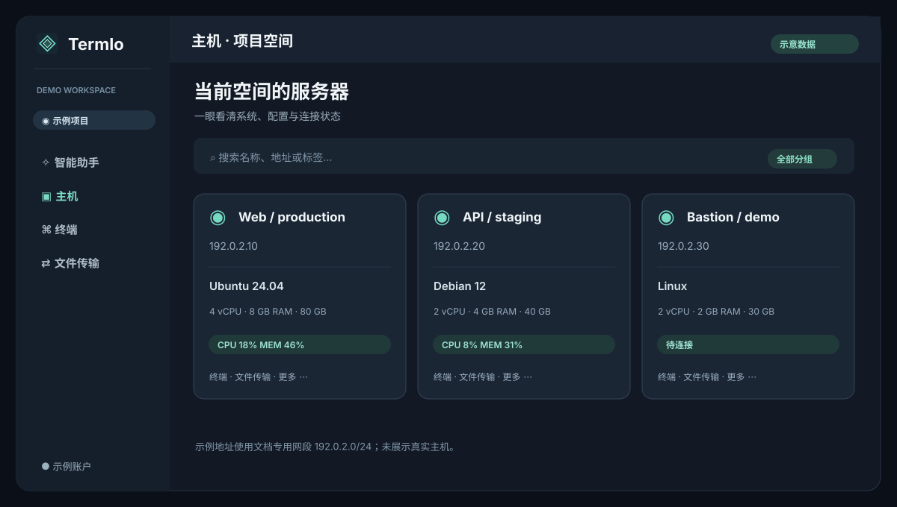
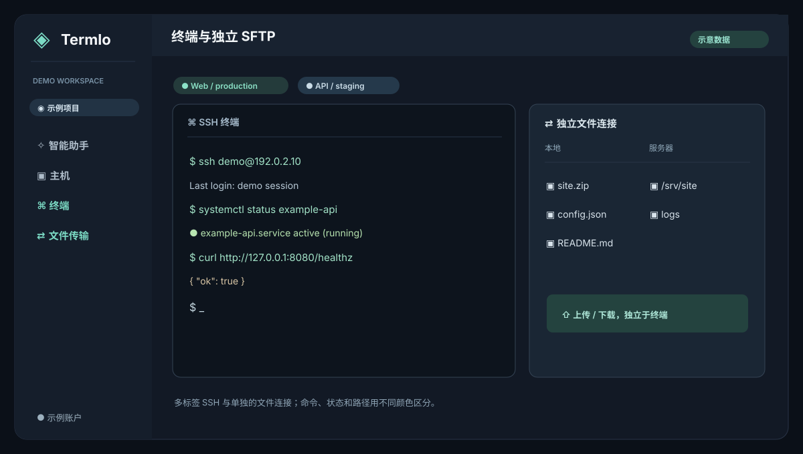
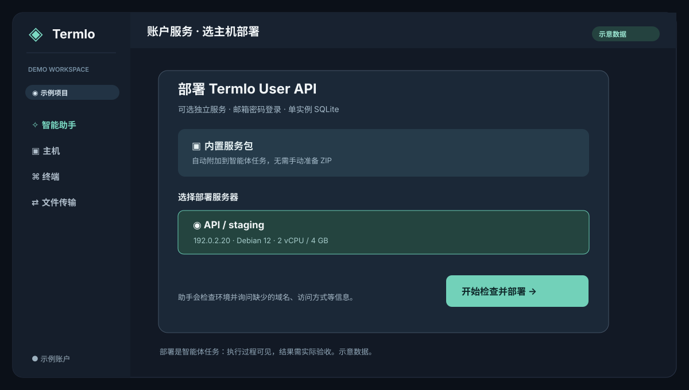

# Termlo

[中文](#中文) · [English](#english)


## 中文

**Termlo，让服务器管理更省心。** 它保留 SSH 多标签终端与独立 SFTP，让智能体在你选定的主机上检查环境、讨论方案、执行命令并核对结果。桌面端由 **Electron、JavaScript、xterm.js 和 ssh2** 构成；先前用于分析的 REA 是 Rust 项目，但不是 Termlo 的运行框架。

### 一眼了解

以下是**虚构数据制作的界面示意图**，没有截取真实账户、主机或任务。

| 项目空间与主机 | SSH 终端与独立 SFTP |
| --- | --- |
| [](docs/intro/hosts.md) | [](docs/intro/terminal.md) |
| [主机与空间介绍](docs/intro/hosts.md) | [终端与文件连接介绍](docs/intro/terminal.md) |

| 智能助手 | 可选账户服务 |
| --- | --- |
| [](docs/intro/agent.md) | [](docs/intro/account-api.md) |
| [Plan、自主执行与验收](docs/intro/agent.md) | [选主机一键发起部署](docs/intro/account-api.md) |

### 下载与使用

从 [Releases](https://github.com/areming/Termlo/releases) 下载 **1.1.0**：Windows x64、macOS Intel 或 Apple Silicon。安装包暂未签名，macOS 首次打开可能需要在系统设置中允许。详见[发布与兼容说明](RELEASING.md)。

1. 添加主机，首次连接核对 SSH 指纹。需要跳板机时，在主机编辑页选择已保存的跳板主机。
2. 使用终端或单独连接 SFTP；终端提供命令高亮，也能切回原始配色。
3. 在助手中填写兼容 OpenAI 的服务地址、模型和密钥。使用 **Plan** 讨论并确认方案，或开启自主任务；执行过程可在执行台看到。
4. 如需跨设备账户，点击助手顶部的**账户服务**，选择一台主机。Termlo 会附上服务包并启动智能体任务，检查部署条件、询问缺少的信息、执行和验收。该服务是可选的，普通 SSH 不需要注册。

智能体使用所选 SSH 账户的权限。主机账本是状态参考，不是整机快照；任意命令和多机操作无法保证自动回滚。模型提供商会接收任务、所选主机信息和必要输出。高影响任务应先确认目标及恢复手段。

### 从源码运行

需要 Node.js 24.13+ 和 npm：

```sh
npm ci
npm test
npm run start
```

在对应系统构建安装包：`npm run dist:win` 或 `npm run dist:mac`。推送 `v*` 标签时，[GitHub Actions](.github/workflows/build-installers.yml) 会构建各平台安装包。独立账户服务的接口、Swagger 与手动部署说明见[服务文档](services/user-api/README.md)。

为兼容旧数据，Termlo 继续使用 `Termus` 数据目录。本仓库尚未选择开源许可证；公开源码不代表授予复用或再分发许可。

## English

**Termlo makes server management easier.** It combines multi-tab SSH and independent SFTP with an agent that can inspect selected hosts, discuss a plan, run commands, and verify results. The desktop app is built with **Electron, JavaScript, xterm.js, and ssh2**. REA, used in earlier analysis, is a Rust project but is not Termlo's runtime.

### See it at a glance

All four illustrations use **fictional demo data**. They contain no real accounts, hosts, or task output.

- [Hosts and project spaces](docs/intro/hosts.md) · [SSH and independent SFTP](docs/intro/terminal.md)
- [Agent Plan and execution](docs/intro/agent.md) · [Optional account API deployment](docs/intro/account-api.md)

### Download and start

Download **1.1.0** for Windows x64, macOS Intel, or Apple Silicon from [Releases](https://github.com/areming/Termlo/releases). The installers are unsigned; see the [release notes](RELEASING.md) for compatibility and installation limits.

Add a host and verify its SSH fingerprint. Use a terminal or connect SFTP independently. To use the agent, configure an OpenAI-compatible endpoint and model, then choose hosts and start a Plan or autonomous task. Commands and checks appear in the execution console.

The optional account API provides email/password identities. In Assistant, click **Account service**, select a host, and start the deployment task. Termlo supplies the bundled service package; the agent checks the target, asks for missing network details, deploys, and verifies. Local SSH use requires no account. [Read the deployment guide](docs/intro/account-api.md).

The agent has the SSH permissions of the selected account. Host tracking is a reference, not a full machine snapshot or guaranteed rollback. Task details and relevant command output are sent to the model provider you configure. Confirm target and recovery options before high-impact changes.

### Build from source

Use Node.js 24.13+ and npm:

```sh
npm ci
npm test
npm run start
```

Build on the target operating system with `npm run dist:win` or `npm run dist:mac`. Tagged releases use the [GitHub Actions workflow](.github/workflows/build-installers.yml). The [standalone account API](services/user-api/README.md) includes Swagger and manual deployment instructions. The legacy `Termus` data directory remains in use for compatibility. No open-source license has been selected yet.
