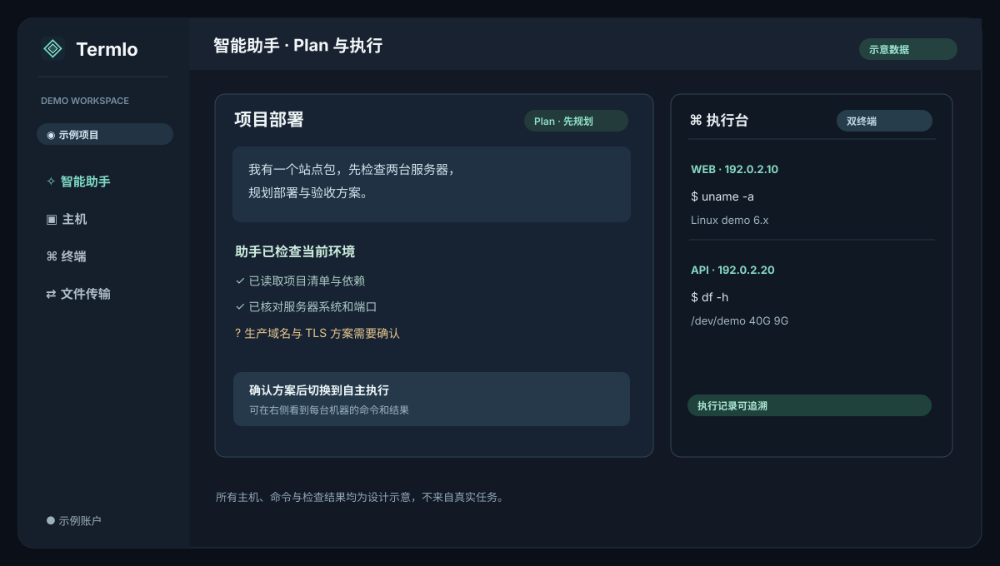

# 智能助手 / Agent workbench

[返回首页 / Home](../../README.md)

图中的主机、命令与检查结果均为示意。填写兼容 OpenAI 的接口地址、模型名与密钥后，可在 **Plan** 模式先讨论方案，由助手通过选择题补齐关键信息，再确认执行；也可直接启动自主任务。选定的主机限定了本次任务范围，执行台按主机展示命令与输出，并允许打开交互终端手动接管。

主机状态账本为跨会话、跨模型的简要参考，每次模型调用前会重新核对轻量状态；它不能替代现场检查、整机快照或恢复方案。任务结果应以实际验证为准。

The hosts, commands, and checks shown are fictional. Configure an OpenAI-compatible model, then discuss a Plan with interactive choices before executing, or start an autonomous task. The selected hosts define the task scope. The execution console shows per-host commands and output, and an interactive terminal can take over manually. Host tracking is a compact reference, not a machine snapshot or a substitute for verification.
